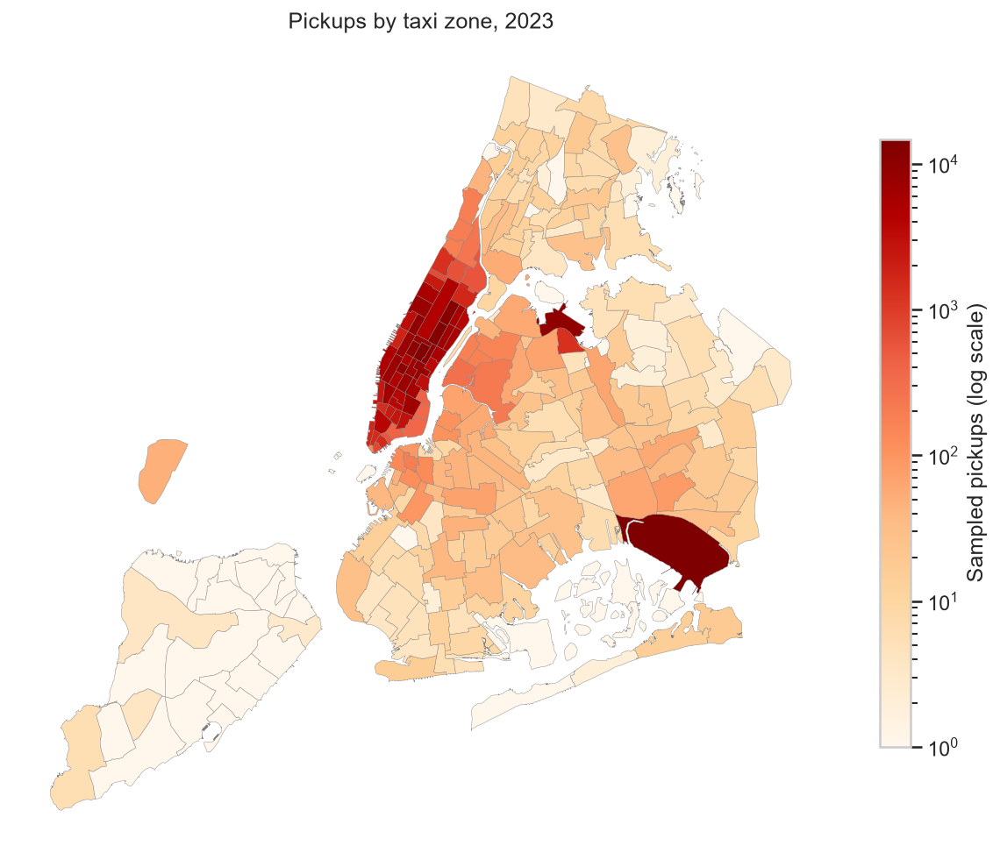
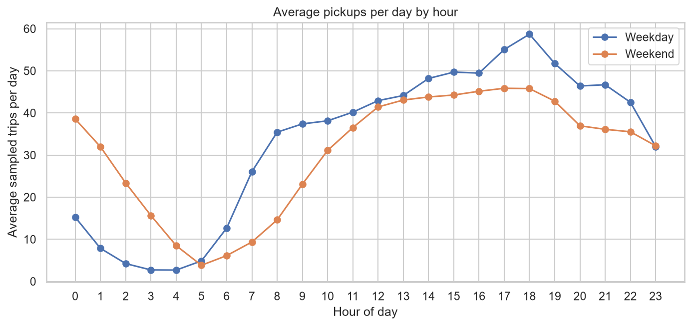
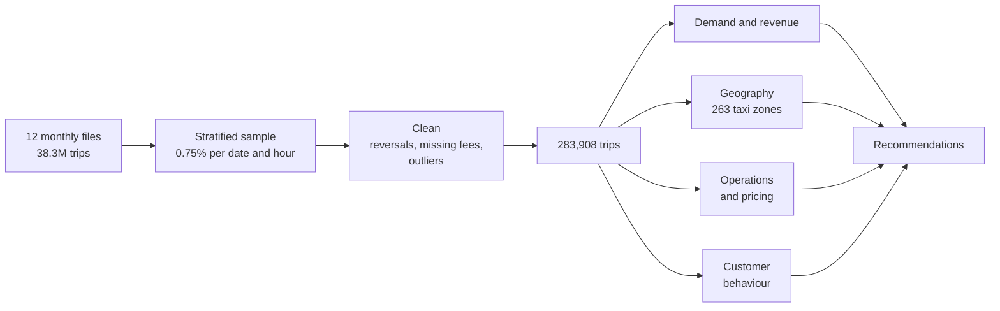
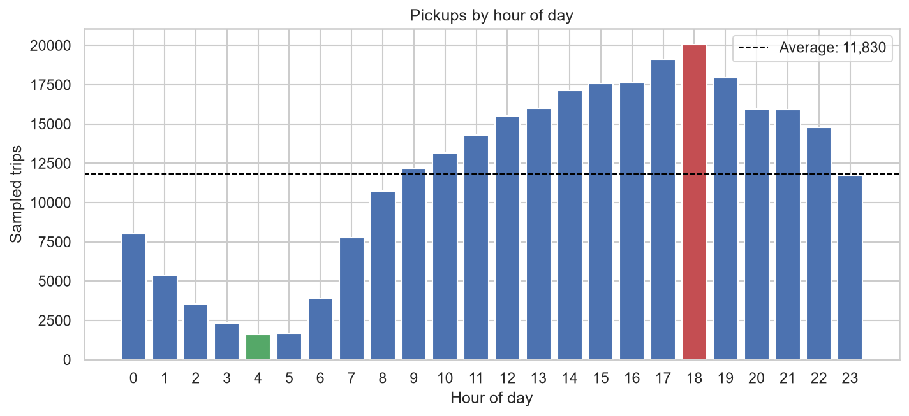
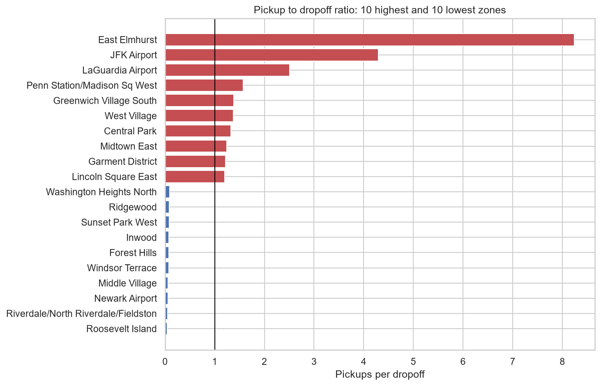
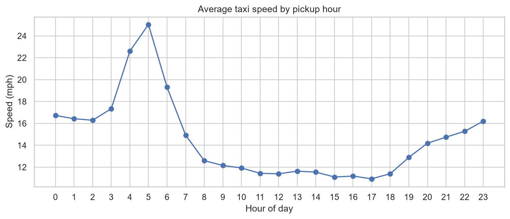
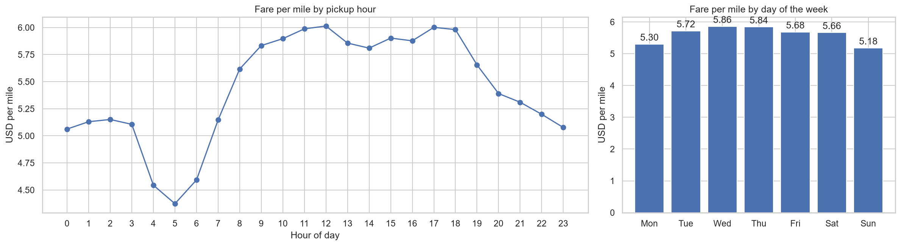
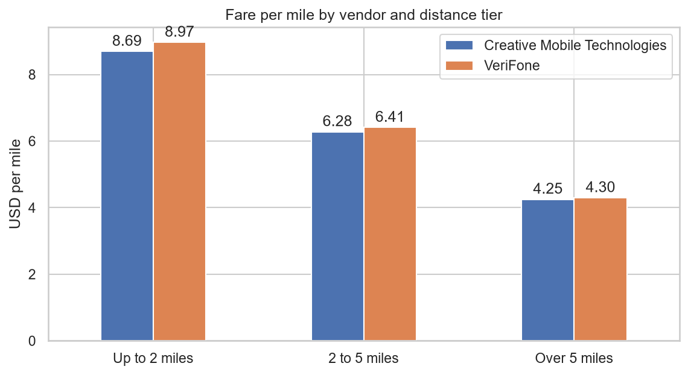
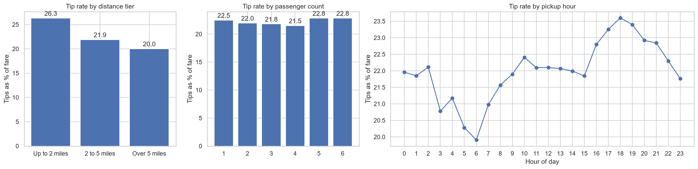

# NYC Yellow Taxis in 2023

**Demand, revenue, geography, operations and pricing across 38.3 million New York City taxi trips.**

By **Rishabh Jain**


This project draws a stratified sample from 38.3 million yellow taxi records published for 2023. It cleans data quality issues and studies when, where and how people travel. The findings identify operational decisions to evaluate, rather than proving an optimal dispatch or pricing policy.

**Explore:** [Visual report](https://rishabhjain9196.github.io/nyc-taxi-eda/) · [Notebook](notebooks/nyc_taxi_eda.ipynb) · [Report](docs/report.md) · [Methods notes](docs/notes.md) · [Data](data/README.md)

## Interactive report

- The [published report](https://rishabhjain9196.github.io/nyc-taxi-eda/) has ten interactive charts, a selectable zone map, data tables and CSV downloads.
- It explains sampling, cleaning, metric denominators, the Python libraries and the limits of operational recommendations.
- Open `docs/index.html` locally to read the same report. Its Plotly.js 4.1.1 bundle is stored locally under the [MIT licence](docs/plotly-LICENSE.txt). No external map or chart service is required.
- After generating the cleaned sample with the notebook, run `python scripts/export_report_data.py` in the project environment. It reads `data/processed/trips_clean.parquet` and the public taxi-zone shapefile, then exports only aggregates and simplified boundaries.

<p align="center">
  
  
</p>

## Key results

| Measure | Value |
| --- | ---: |
| Trips in 2023 | 38,310,226 |
| Sampled trips (0.75% by date and hour) | 287,296 |
| Trips after cleaning | 283,908 |
| Estimated recorded payments in 2023 | $1.10 billion |
| Busiest hour | 18:00, about 2.68 million trips a year |
| Busiest pickup zone | JFK Airport, 5.2% of trips |
| Slowest hour | 17:00, average 10.9 mph |
| Credit card share of trips | 78.7% |
| Recorded tips / fares on qualifying credit card trips | 22.3% |

Recorded payments include fees, tolls and card tips. They exclude cash tips and do not subtract operating costs, so they are not driver profit.

## Analysis pipeline



## Findings

### Demand follows the working day on weekdays and the night on weekends



- Pickups peak at 18:00 and are lowest at 04:00.
- Weekday demand rises steeply from 06:00 and peaks with the evening commute.
- Weekend pickups at midnight are 2.5 times the weekday level.
- Thursday is the busiest day and Sunday the quietest. May and October are the busiest months.

### Airports and Midtown dominate pickups



- JFK Airport, Upper East Side South and Midtown Center lead pickups. Eight of the ten busiest zones are in Manhattan.
- JFK and LaGuardia produce 4.3 and 2.5 pickups for every dropoff. This suggests a repositioning question, but the records do not measure empty driving.
- Residential zones in upper Manhattan, Queens, Brooklyn and the Bronx receive more than ten dropoffs for every pickup.

### Congestion slows taxis and raises the price per mile

<p align="center">
  
  
</p>

- Average speed falls from 25.0 mph at 05:00 to 10.9 mph at 17:00.
- Fare per mile follows the same pattern, from $4.37 at 05:00 to about $6.00 in the afternoon, because the meter also charges for slow traffic.
- Short trips around Penn Station, the Garment District and Midtown South average under 3 mph at peak times.

### Pricing and tips

<p align="center">
  
  
</p>

- Both main vendors charge almost the same rate. Fare per mile falls from about $9 under 2 miles to about $4.30 over 5 miles.
- Fares do not depend on group size, so fare per passenger falls by 84% from one to six passengers.
- Short trips receive the highest tip rate, at 26.3%. Trips over 5 miles receive 20.0%.

## Recommendations

| Area | Recommendation |
| --- | --- |
| Dispatch | Test time-specific supply profiles, measuring passenger waits and vehicle utilisation. |
| Routing | Investigate slow Midtown zone pairs with street-level paths and larger samples. |
| Positioning | Evaluate airport queues and night-time positioning using waiting time and earnings per working hour. |
| Empty returns | Measure actual empty mileage before designing a repositioning policy. |
| Pricing | Assess affordability and demand response before proposing additional surcharges or group products. |

The [report](docs/report.md) explains each finding and recommendation in detail.

## Data quality issues handled

| Issue | Share of sample | Treatment |
| --- | ---: | --- |
| Negative charges, all from one vendor | 1.0% | Removed, because they reverse other trips |
| Missing passenger count, rate code and fees, with payment type 0 | 3.4% | Imputed; congestion and airport fees inferred from each trip's fare breakdown |
| Zero passengers | 1.5% | Set to one passenger |
| Impossible durations, distances and speeds | 0.2% | Removed |

The [methods notes](docs/notes.md) describe every decision, metric definition and known limitation.

## Quick start

Requirements: Python 3.12 and about 2 GB of free disk space.

```bash
python -m venv .venv
source .venv/bin/activate        # Windows: .venv\Scripts\activate
pip install -r requirements.txt
python scripts/download_data.py
```

Open [the notebook](notebooks/nyc_taxi_eda.ipynb), select the `.venv` kernel and run all cells. A full run takes about five minutes and saves every chart to `docs/figures`.

## Repository structure

```text
notebooks/nyc_taxi_eda.ipynb   Full analysis with outputs
docs/report.md                 Detailed findings and recommendations
docs/index.html                Visual report, published with GitHub Pages
docs/notes.md                  Methods, definitions and data issues
docs/figures/                  27 charts produced by the notebook
scripts/download_data.py       Downloads the 2023 trip records and taxi zones
data/README.md                 Data sources and layout
requirements.txt               Pinned dependencies
```

## Data source

Trip records and taxi zones are published by the [NYC Taxi and Limousine Commission](https://www.nyc.gov/site/tlc/about/tlc-trip-record-data.page).
