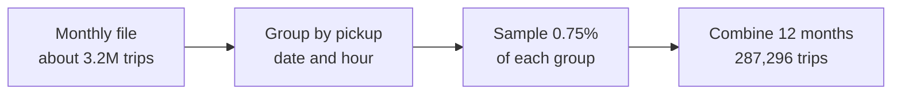
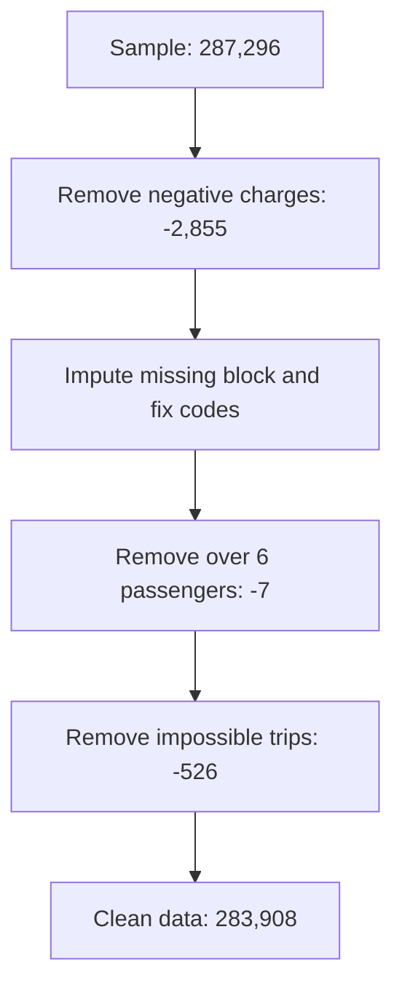

# Methods Notes

These notes explain how the analysis was done, why each decision was made and what to watch for when working with the NYC taxi data. They complement the [report](report.md), which focuses on findings.

## Contents

1. [Dataset overview](#1-dataset-overview)
2. [Sampling](#2-sampling)
3. [Data quality issues](#3-data-quality-issues)
4. [Cleaning pipeline](#4-cleaning-pipeline)
5. [Metric definitions](#5-metric-definitions)
6. [Analysis pitfalls](#6-analysis-pitfalls)
7. [Reproducing the results](#7-reproducing-the-results)
8. [Glossary](#8-glossary)

## 1. Dataset overview

Each row is one completed yellow taxi trip. The 19 columns fall into five groups.

| Group | Columns | Notes |
| --- | --- | --- |
| Time | `tpep_pickup_datetime`, `tpep_dropoff_datetime` | When the meter started and stopped |
| Location | `PULocationID`, `DOLocationID` | Taxi zone IDs from 1 to 263, plus 264 (unknown) and 265 (outside NYC) |
| Trip | `passenger_count`, `trip_distance`, `RatecodeID`, `store_and_fwd_flag` | Passenger count is entered by the driver |
| Payment | `VendorID`, `payment_type` | Vendor is the meter technology provider |
| Charges | `fare_amount`, `extra`, `mta_tax`, `tip_amount`, `tolls_amount`, `improvement_surcharge`, `congestion_surcharge`, `airport_fee`, `total_amount` | `total_amount` excludes cash tips |

Variable types used in the analysis:

- **Categorical:** `VendorID`, `RatecodeID`, `PULocationID`, `DOLocationID`, `payment_type`, day of the week.
- **Ordinal:** pickup hour, month and quarter.
- **Numerical:** `passenger_count`, `trip_distance`, trip duration and all charge columns.
- **Date and time:** the pickup and dropoff timestamps.

## 2. Sampling



- **Why sample:** 38.3 million rows make cleaning and plotting slow on a single machine. A sample of about 250,000 to 300,000 trips keeps every step fast while preserving the patterns.
- **Why stratify by date and hour:** A plain random sample would preserve proportions on average, but stratifying guarantees that every hour of every day is represented. Sampling by hour alone would mix busy and quiet days.
- **Fraction:** 0.75% gives 287,296 trips. A 5% sample would give about 1.9 million rows, which defeats the purpose of sampling.
- **Check:** Each month's share of the sample matches its share of the population to within 0.01 percentage points.
- **Scaling:** Sample counts and revenue are divided by 0.0075 to estimate full-year totals.

## 3. Data quality issues

| Issue | Evidence | Decision |
| --- | --- | --- |
| Two airport fee columns | January uses `airport_fee`; later months use `Airport_fee`. No row has both. | Combine into one column. |
| Negative charges | 1.0% of trips. All from VendorID 2. 98.5% have payment types dispute, cash or no charge. 87% match a positive trip with the same time, zones and amount. | Remove. These rows reverse other trips, and keeping them cancels real revenue. |
| Missing block | 3.4% of trips have no passenger count, rate code, store flag, congestion surcharge or airport fee, and all have `payment_type` 0. | Impute, then keep payment type 0 as `Not recorded`. |
| Payment type 0 | Not defined in the 2023 data dictionary. Appears only in the missing block. | Keep as its own category. Recoding to credit card would distort payment and tip analysis. |
| Rate code 99 | Not defined in the data dictionary. 0.6% of trips. | Treat as missing and set to the mode, 1. |
| Zero passengers | 1.5% of trips. | Set to 1. A paid trip carries at least one passenger. |
| Clock and meter errors | Negative and zero durations, durations up to 24 hours, distances up to 44,410 miles and speeds above 190,000 mph. | Remove using the rules in section 4. |
| Unknown zones | IDs 264 and 265 are not in the shapefile. | Keep the trips. Label the IDs `Unknown` and `Outside NYC`. |

### Inferring missing fees

For complete trips, `total_amount` equals the sum of all charges. For trips in the missing block, the gap between the total and the known charges reveals which fees were applied. The congestion surcharge is set to $2.50 when the gap is at least $2.50, and the airport fee to $1.75 when the remaining gap is at least $1.75.

| Gap | Share of affected trips | Inferred fees |
| --- | ---: | --- |
| $2.50 | 89% | Congestion surcharge $2.50 |
| $0.00 | 9% | No congestion surcharge or airport fee |
| $4.50 | 1% | Congestion surcharge $2.50 and airport fee $1.75 |

Setting the missing fees to zero would undercount congestion charges for 89% of these trips.

## 4. Cleaning pipeline



Rules for impossible trips:

| Rule | Trips removed | Reason |
| --- | ---: | --- |
| Distance under 0.1 miles and fare above $300 | 1 | Meter error |
| Zero distance and fare between different zones | 16 | A trip between zones cannot cover no distance |
| Distance above 250 miles | 6 | Beyond any realistic taxi trip |
| Duration of zero minutes or less | 122 | Clock error |
| Duration above 5 hours | 249 | Meter left running |
| Average speed above 80 mph | 152 | Distance or clock error |

Some trips break more than one rule, so the rows removed (526) are fewer than the sum of the rule counts.

Columns are not standardised. Exploratory analysis needs values in real units, such as dollars and miles.

## 5. Metric definitions

| Metric | Definition | Why this definition |
| --- | --- | --- |
| Trip duration | Dropoff time minus pickup time, in minutes | |
| Speed by hour | Total miles divided by total hours of trips in that hour | Weighting by distance avoids distortion from very short trips |
| Route speed | Average distance divided by average duration for a pickup zone, dropoff zone and hour | Only combinations with at least five trips are compared, and same-zone trips are excluded |
| Fare per mile | Total fares divided by total miles in a group | A mean of per-trip ratios is inflated by very short trips, where the starting charge dominates |
| Fare per mile per passenger | Fare per mile divided by passenger count | |
| Tip rate | Total tips divided by total fares, credit card trips only | Cash tips are not recorded |
| Pickup to dropoff ratio | Pickups divided by dropoffs per zone, for zones with at least 100 trips | Small zones give unstable ratios |
| Night | Pickups from 23:00 to 04:59 | Matches 11 PM to 5 AM |
| Weekday and weekend demand | Trips per hour divided by the number of weekdays or weekend days | 2023 has 260 weekdays and 105 weekend days, so totals would favour weekdays |
| Surcharge frequency | Share of trips where a charge is greater than zero | |

## 6. Analysis pitfalls

- **Averaging ratios:** The mean of per-trip fare per mile is $11.03, because trips of a few hundred yards carry the full starting charge. Total fares divided by total miles gives $5.61.
- **Tips on cash trips:** Cash tips are recorded as zero. Including cash trips would understate tipping and make tip rate depend on payment mix.
- **Weekday totals:** Comparing total weekday trips with total weekend trips mostly reflects the number of days. Use trips per day.
- **Shapefile joins:** Join on `LocationID` and check the row count before and after each merge, so that no trips are duplicated or lost.
- **Night hours:** 11 PM to 5 AM covers hours 23, 0, 1, 2, 3 and 4. Including hour 5 adds the start of the morning rise.
- **Mode imputation:** Filling payment type 0 with the mode turns 3.4% of trips into credit card payments, even though many may be cash.
- **Scaling estimates:** Only counts and sums scale with the sampling fraction. Averages, shares and ratios do not.

## 7. Reproducing the results

```bash
python -m venv .venv
source .venv/bin/activate        # Windows: .venv\Scripts\activate
pip install -r requirements.txt
python scripts/download_data.py
```

- The notebook finds the repository root from either the root or the `notebooks` folder.
- It writes the sample and cleaned data to `data/processed` and charts to `docs/figures`.
- The random seed is fixed at 42, so the same data gives the same sample.
- The TLC occasionally updates published files. A later download may differ slightly.

## 8. Glossary

| Term | Meaning |
| --- | --- |
| TLC | NYC Taxi and Limousine Commission, which licenses taxis and publishes the trip records |
| TPEP | Taxicab Passenger Enhancement Project, the in-car meter and payment system |
| Vendor 1 | Creative Mobile Technologies |
| Vendor 2 | VeriFone |
| Rate code 1 to 6 | Standard, JFK, Newark, Nassau or Westchester, negotiated fare, group ride |
| Congestion surcharge | $2.50 charge for trips that start, end or pass through Manhattan south of 96th Street |
| Airport fee | $1.75 charge for pickups at JFK and LaGuardia |
| Extra | Rush hour and overnight surcharges |
| Improvement surcharge | $1.00 charge on every metered trip |
