# NYC Yellow Taxi Trips 2023: Analysis Report

**Rishabh Jain**

This report summarises an exploratory analysis of all yellow taxi trips recorded in New York City in 2023. It describes the data, the cleaning steps, the main patterns, and recommendations for dispatch, positioning and pricing. All charts come from the [notebook](../notebooks/nyc_taxi_eda.ipynb).

## Contents

1. [Summary](#1-summary)
2. [Data and sampling](#2-data-and-sampling)
3. [Data cleaning](#3-data-cleaning)
4. [Demand patterns](#4-demand-patterns)
5. [Revenue and fares](#5-revenue-and-fares)
6. [Geography](#6-geography)
7. [Operational efficiency](#7-operational-efficiency)
8. [Pricing](#8-pricing)
9. [Customer experience](#9-customer-experience)
10. [Recommendations](#10-recommendations)
11. [Limitations](#11-limitations)

## 1. Summary

- New York City's yellow taxis completed 38.3 million trips in 2023, earning an estimated $1.10 billion.
- Demand peaks at 18:00 on weekdays. Weekend demand shifts towards late evening and midnight.
- JFK Airport is the busiest pickup zone, and eight of the ten busiest zones are in Manhattan.
- Congestion cuts average speed from 25.0 mph at 05:00 to 10.9 mph at 17:00, and raises the fare per mile by over a third.
- Airports produce several pickups for every dropoff, while residential zones mostly receive dropoffs. This drives empty travel in both directions.
- Recommendations focus on adding supply at the evening peak, positioning cars at airports and nightlife areas, and targeting surcharges at the busiest hours.

## 2. Data and sampling

| Item | Value |
| --- | --- |
| Source | NYC Taxi and Limousine Commission trip records |
| Period | January to December 2023 |
| Trips | 38,310,226 |
| Columns | 19, covering times, zones, distance, passengers, payment and nine charge fields |
| Zones | 263 taxi zones in a shapefile, plus IDs 264 and 265 for unknown and out-of-city locations |

Working with all 38.3 million rows is slow on a single machine, so the analysis uses a stratified random sample.

- The sample takes 0.75% of trips from every combination of pickup date and hour, using a fixed random seed.
- This gives 287,296 trips, within the 250,000 to 300,000 range that keeps the analysis fast.
- Sampling by date and hour, rather than by hour alone, preserves busy days, quiet days and holidays.
- Each month's share of the sample matches its share of all trips to within 0.01 percentage points.

Counts from the sample are divided by 0.0075 to estimate full-year totals.

## 3. Data cleaning

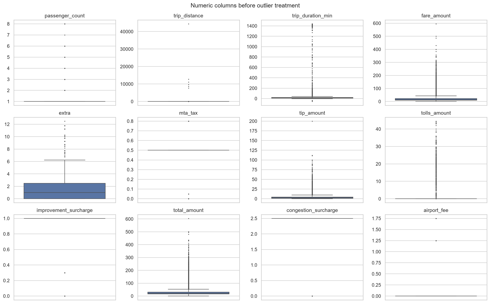

| Step | Rows affected | Treatment |
| --- | ---: | --- |
| Drop `store_and_fwd_flag` | All rows | The flag only records offline upload, and 0.6% of trips are flagged. |
| Combine `airport_fee` and `Airport_fee` | All rows | January uses one name and February to December the other. No row has both. |
| Negative charges | 2,855 (1.0%) | Removed. All come from VendorID 2, and 87% match a positive trip with the same time, zones and amount, so they are reversals. |
| Missing block with `payment_type` 0 | 9,804 (3.4%) | Passenger count and rate code set to the mode of 1. Congestion surcharge and airport fee inferred from the gap between the total and the other charges. |
| Zero passengers | 4,324 (1.5%) | Set to 1, because a paid trip carries at least one passenger. |
| Rate code 99 | 1,583 (0.6%) | Not defined in the data dictionary, so set to the mode of 1. |
| More than six passengers | 7 | Removed, because larger groups exceed taxi capacity. |
| Impossible trips | 526 (0.2%) | Removed. See the rules below. |

The rules for impossible trips are:

- A distance under 0.1 miles with a fare above $300 (1 trip).
- Zero distance and zero fare between different zones (16 trips).
- A distance above 250 miles (6 trips).
- A duration of zero minutes or less (122 trips), or above five hours (249 trips).
- An average speed above 80 mph (152 trips).

Trips with `payment_type` 0 are kept as a separate `Not recorded` category. Replacing them with credit card payments would overstate card use and distort the tip analysis.

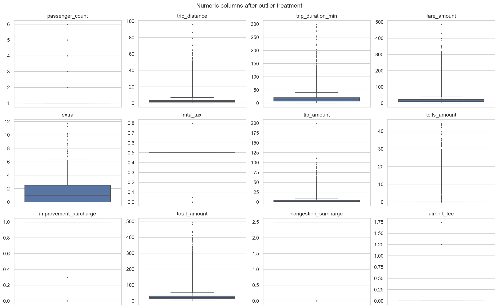

The cleaned data has 283,908 trips, 98.8% of the sample. The maximum distance falls from 44,410 miles to 96 miles, and the maximum duration from about 24 hours to 5 hours.

## 4. Demand patterns

- Pickups peak at 18:00, with an estimated 2.68 million trips in that hour across 2023.
- The five busiest hours run from 15:00 to 19:00, each with more than 2.3 million trips.
- Demand is lowest at 04:00, at under a tenth of the peak.

- Weekdays show a commuter pattern. Demand rises steeply from 06:00 to 08:00 and peaks at 18:00.
- Weekends show a late-night pattern. Pickups at midnight are 2.5 times the weekday level.
- On weekends, the morning rise starts about two hours later than on weekdays.

| Day | Average sampled trips per day |
| --- | ---: |
| Busiest: Thursday | 856 |
| Quietest: Sunday | 677 |

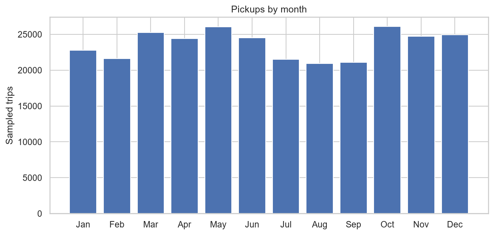

- May and October are the busiest months, with about 3.47 million trips each.
- August is the quietest, with about 2.79 million trips.

## 5. Revenue and fares

Revenue analysis uses trips with a positive fare and total. Zero-distance trips are kept, because trips that start and end in the same zone can still be valid and paid.

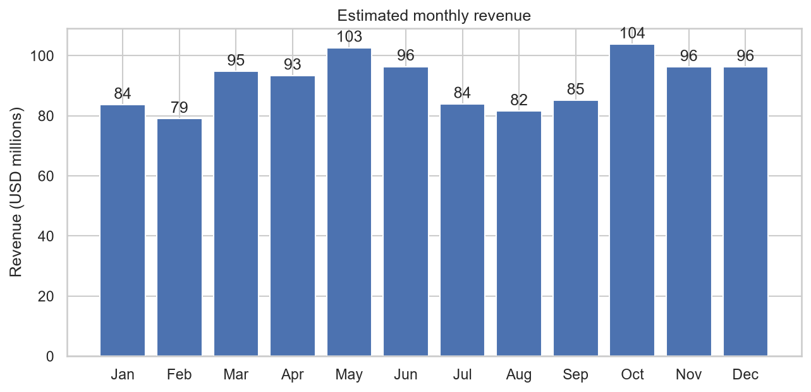

- Estimated 2023 revenue is $1.10 billion.
- Monthly revenue ranges from $79 million in February to $104 million in October.

| Quarter | Share of revenue |
| --- | ---: |
| Q1 | 23.5% |
| Q2 | 26.7% |
| Q3 | 22.8% |
| Q4 | 27.0% |

| Relationship | Correlation |
| --- | ---: |
| Fare and distance | 0.947 |
| Fare and duration | 0.804 |
| Tip and distance, credit card trips | 0.735 |
| Fare and passenger count | 0.045 |

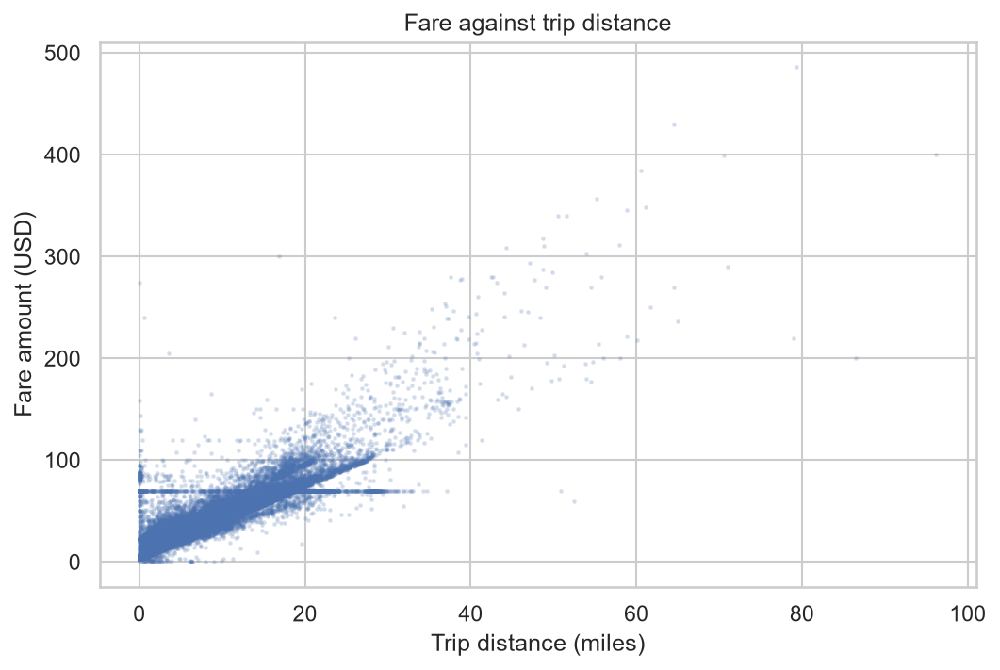

- Fare rises almost linearly with distance and duration, because the meter charges for both.
- Fare does not depend on the number of passengers.
- Tips are recorded only for credit card payments, so the tip analysis uses credit card trips.

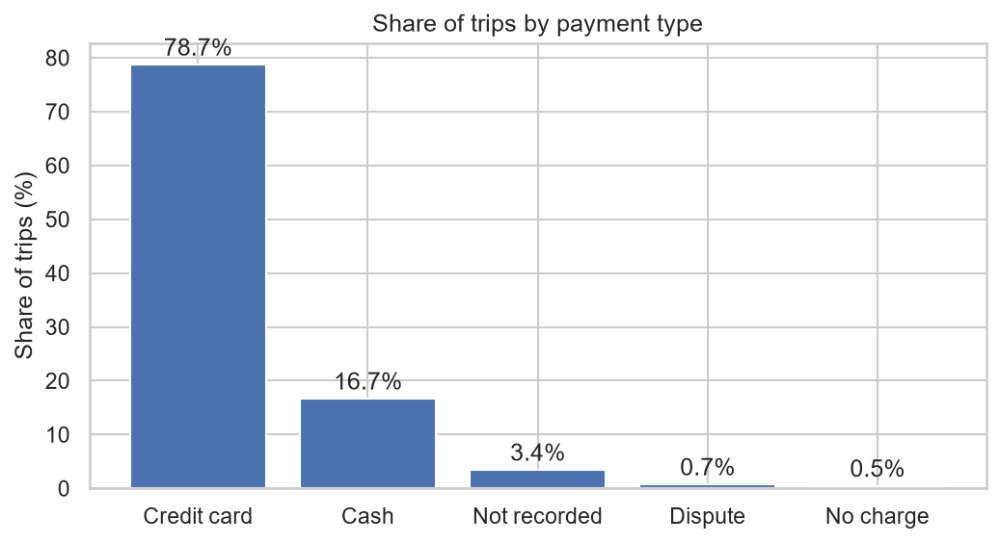

| Payment type | Share of trips |
| --- | ---: |
| Credit card | 78.7% |
| Cash | 16.7% |
| Not recorded | 3.4% |
| Dispute | 0.7% |
| No charge | 0.5% |

## 6. Geography

| Rank | Zone | Borough | Share of pickups |
| ---: | --- | --- | ---: |
| 1 | JFK Airport | Queens | 5.2% |
| 2 | Upper East Side South | Manhattan | 4.7% |
| 3 | Midtown Center | Manhattan | 4.6% |
| 4 | Upper East Side North | Manhattan | 4.2% |
| 5 | Midtown East | Manhattan | 3.5% |
| 6 | Penn Station/Madison Sq West | Manhattan | 3.4% |
| 7 | LaGuardia Airport | Queens | 3.3% |
| 8 | Lincoln Square East | Manhattan | 3.3% |
| 9 | Times Sq/Theatre District | Manhattan | 3.3% |
| 10 | Murray Hill | Manhattan | 2.9% |

- Pickups outside Manhattan and the airports are sparse.
- All 20 Staten Island zones, 24 of 43 Bronx zones and 30 of 69 Queens zones record fewer than 10 sampled pickups in the year.

## 7. Operational efficiency

### 7.1 Speed and slow routes

- Average speed is highest at 05:00, at 25.0 mph, and lowest at 17:00, at 10.9 mph.
- From 08:00 to 18:00, speed stays between 10.9 and 12.6 mph.
- Route speed is calculated for each pickup zone, dropoff zone and hour with at least five sampled trips.

| Slow route | Hour | Average speed |
| --- | ---: | ---: |
| Greenwich Village South to Greenwich Village North | 13:00 | 1.7 mph |
| Midtown South to Garment District | 17:00 | 2.4 mph |
| Penn Station/Madison Sq West to Garment District | 14:00 | 2.9 mph |
| Midtown East to Times Sq/Theatre District | 13:00 | 3.0 mph |

These routes are short trips of under a mile that take 10 to 25 minutes.

### 7.2 Busy zones and flows

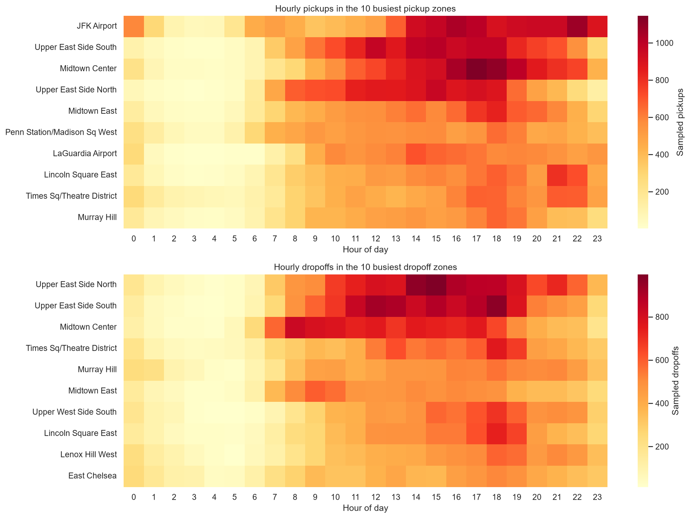

- JFK Airport is busy from 14:00 until midnight, and its pickups peak at 22:00.
- Manhattan zones peak in the afternoon and early evening.
- Dropoffs in Midtown Center peak from 08:00 to 10:00, which reflects commuting into the business district.

| Zone | Pickups per dropoff |
| --- | ---: |
| East Elmhurst | 8.24 |
| JFK Airport | 4.29 |
| LaGuardia Airport | 2.51 |
| Penn Station/Madison Sq West | 1.57 |
| Roosevelt Island | 0.04 |
| Newark Airport | 0.06 |

- East Elmhurst borders LaGuardia Airport, so many of its pickups are likely airport trips.
- Airports and Penn Station are net sources of passengers. Many taxis must arrive empty to meet this demand.
- Residential zones such as Roosevelt Island, Riverdale, Middle Village and Inwood are net destinations. Taxis that end trips there often leave empty.

### 7.3 Night activity

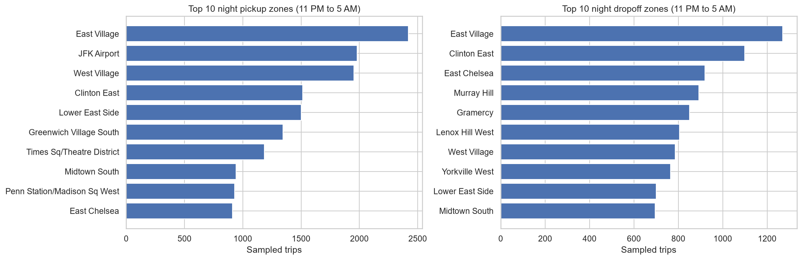

- Night trips, from 11 PM to 5 AM, make up 11.5% of trips and 11.5% of revenue.
- The average night total of $28.99 is the same as the daytime average.
- East Village, JFK Airport and the West Village lead night pickups. East Village also leads night dropoffs.

## 8. Pricing

Fare per mile is total fares divided by total miles in each group. A simple average of per-trip ratios would be dominated by very short trips, where the starting charge is spread over a fraction of a mile.

| Passengers | Fare per mile | Fare per mile per passenger |
| ---: | ---: | ---: |
| 1 | $5.68 | $5.68 |
| 2 | $5.37 | $2.69 |
| 3 | $5.52 | $1.84 |
| 4 | $5.48 | $1.37 |
| 5 | $5.59 | $1.12 |
| 6 | $5.60 | $0.93 |

- Fare per mile is lowest at 05:00, at $4.37, and reaches about $6.00 from midday to 18:00.
- This matches the speed pattern, because the meter also charges for time spent in slow traffic.
- Wednesday and Thursday have the highest fare per mile, at $5.86 and $5.84. Sunday has the lowest, at $5.18.

| Distance | Creative Mobile Technologies | VeriFone |
| --- | ---: | ---: |
| Up to 2 miles | $8.69 | $8.97 |
| 2 to 5 miles | $6.28 | $6.41 |
| Over 5 miles | $4.25 | $4.30 |

- The two main vendors charge almost the same rate. Their fare per mile differs by at most $0.21 in any hour.
- Fare per mile falls with distance, because the fixed starting charge is spread over more miles.
- Vendor 6 has only 49 sampled trips and is excluded from the vendor comparison.

## 9. Customer experience

### 9.1 Tips

- Credit card passengers tip 22.3% of the fare on average.
- Short trips under 2 miles receive the highest tip rate, at 26.3%. Trips over 5 miles receive 20.0%.
- Tip rates peak from 17:00 to 19:00 and are lowest from 05:00 to 06:00.

| Measure | Tip under 10% | Tip over 25% |
| --- | ---: | ---: |
| Average distance | 4.84 miles | 2.31 miles |
| Average fare | $25.66 | $14.43 |
| Average duration | 21.4 minutes | 12.3 minutes |
| Airport trips | 11% | 5% |
| Average passengers | 1.37 | 1.37 |

Low tips come from longer, more expensive and airport trips. Passenger count does not differ between the groups.

### 9.2 Passengers

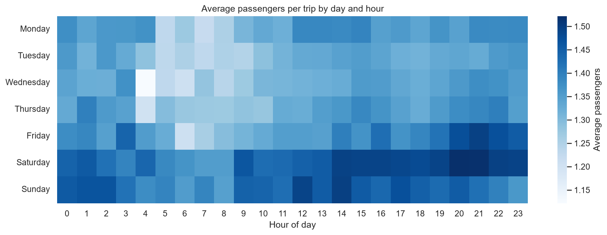

- 77.4% of trips carry one passenger, and the average is 1.38.
- Groups are largest on Friday and Saturday evenings.
- Battery Park, the Seaport, JFK Airport and the Financial District have the highest average group sizes.

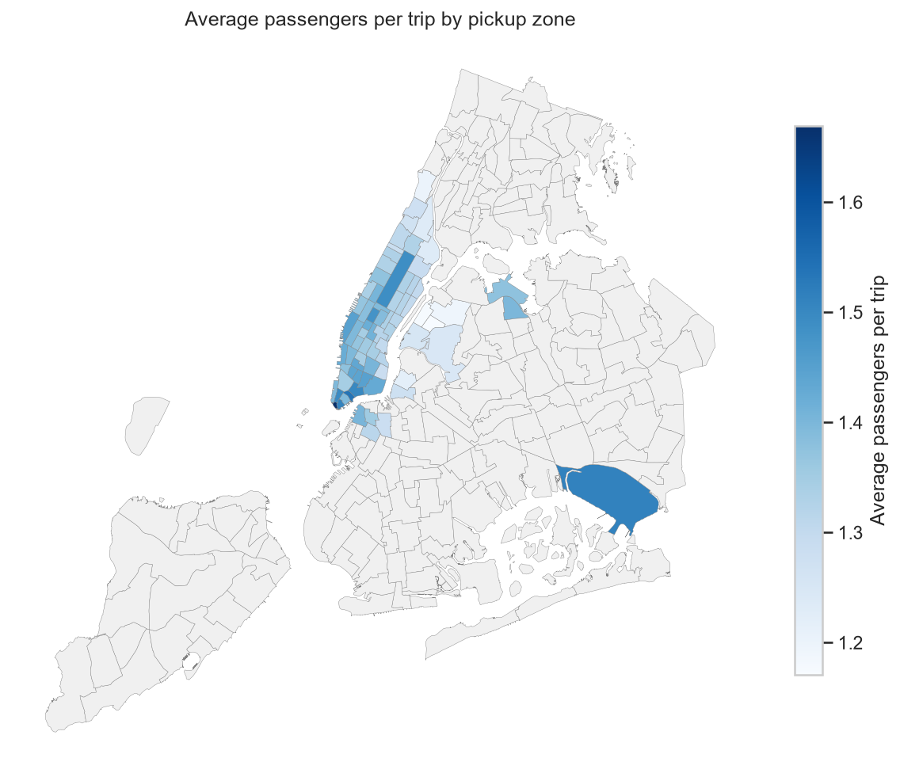

### 9.3 Surcharges

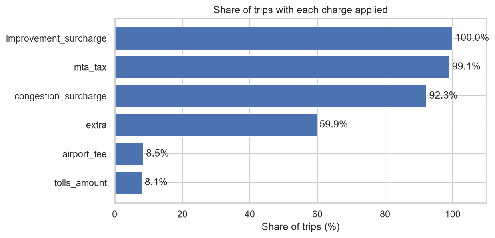

| Charge | Share of trips |
| --- | ---: |
| Improvement surcharge | 100.0% |
| MTA tax | 99.1% |
| Congestion surcharge | 92.3% |
| Extra (rush hour and overnight) | 59.9% |
| Airport fee | 8.5% |
| Tolls | 8.1% |

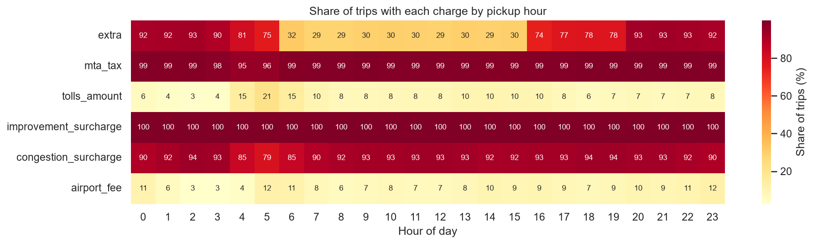

- The extra charge applies mainly from 16:00 to 05:00, which matches the rush-hour and overnight surcharges.
- The congestion surcharge applies to 97.6% of Manhattan pickups but only 6.7% of Bronx pickups.
- Airport fees and tolls concentrate at JFK, LaGuardia and East Elmhurst.

## 10. Recommendations

### Routing and dispatch

- Increase supply from 15:00 to 19:00 on weekdays. The busiest hour, 18:00, carries about 2.7 million trips a year, and speeds fall to about 11 mph.
- Shift weekend supply later. Weekend pickups at midnight are 2.5 times the weekday level, while weekend mornings start about two hours later.
- Avoid short Midtown routes around Penn Station, the Garment District and Midtown South at midday and at 17:00, when some average below 3 mph.

### Positioning

- Keep a queue at JFK and LaGuardia from the afternoon until midnight. The airports produce 2.5 to 4.3 pickups for every dropoff.
- Concentrate daytime supply in Midtown and the Upper East Side. These zones lead both pickups and dropoffs.
- Position cars in the East Village, the West Village and at JFK from 11 PM to 5 AM, when these zones lead pickups.
- Plan return trips from residential zones where dropoffs outnumber pickups by more than ten to one.

### Pricing

- Fares already rise with congestion, from $4.37 per mile at 05:00 to about $6.00 per mile in the afternoon. Further surcharges should target the 15:00 to 19:00 peak rather than the whole day.
- Consider a group product. Fares do not change with group size, so fare per passenger falls by 84% from one to six passengers.
- Review long and airport trips. They receive the lowest tip rates, which reduces driver earnings on the longest journeys.

## 11. Limitations

- The analysis uses a 0.75% sample, so estimates for small zones or rare routes are uncertain. Route speeds use combinations with at least five trips.
- Cash tips are not recorded, so tip analysis covers credit card trips only.
- Inferred congestion and airport fees assume that the fare breakdown is complete. They match the observed $2.50 and $1.75 charges for most affected trips.
- Trip records show completed journeys only. They do not show unmet demand, waiting times or empty driving.
